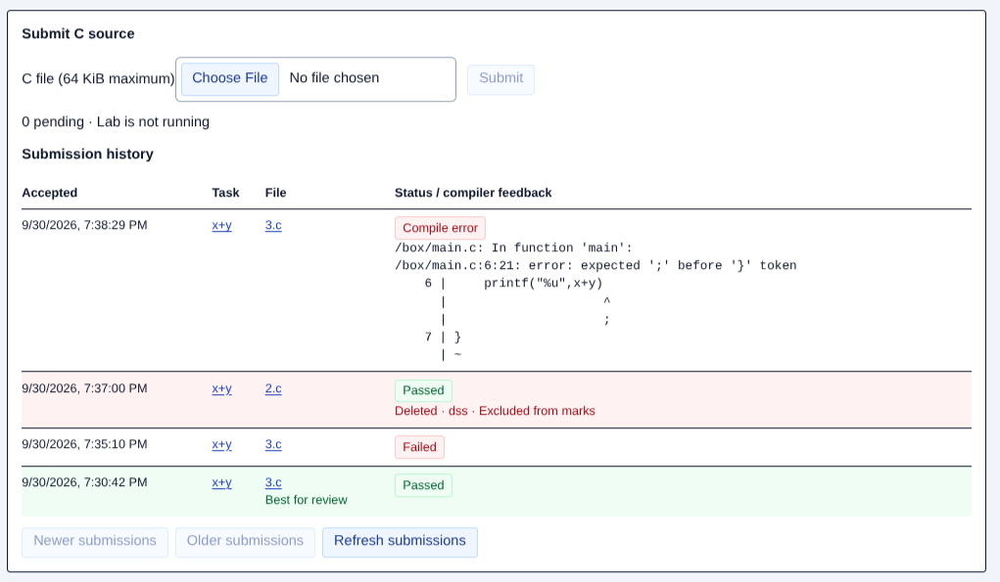
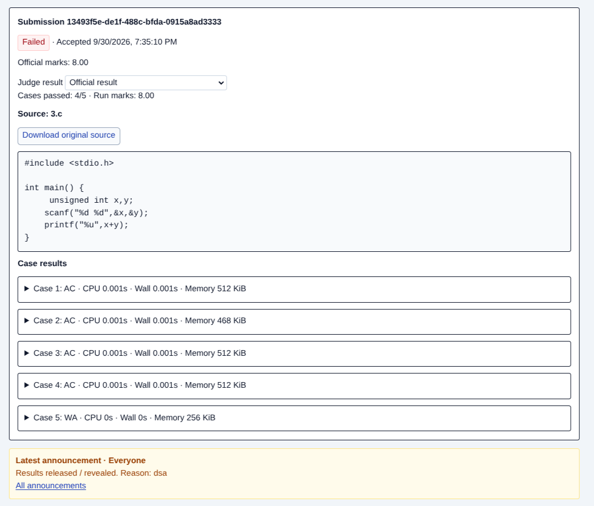
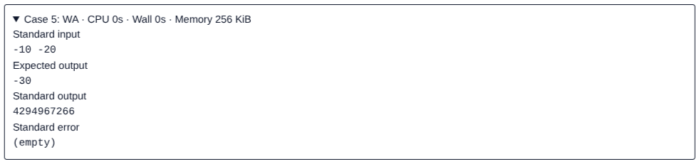

# cJudge TA Guide

**Review flow:** sign in → assigned lab → find student → inspect submissions → claim and mark each enabled task → finalize.

## 1. Open an assigned lab

- Sign in with your TA account. Open **Assigned labs**, then search for the student's roll number or name.
- TA pages show automatic marks and submission source even before release. Accepted-case streams remain hidden.
- TA marking starts after the lab's first result release, even if student visibility is later hidden.
- Archived labs remain readable, but marking and account actions are locked.

## 2. Choose the submission

1. On the TA student page, scan **Submissions**. History is newest first; use **Older**/**Newer** if needed.
2. Start with the green **Best for review** row: the newest active attempt tied for the highest official score for that task.
3. Click its filename to open the submission. Check acceptance time and status.

Red **Deleted** rows show a reason and are excluded from marks. A **Passed** status is distinct from the green review highlight.

The review highlight selects the newest tied attempt; counted task marks use the best score, with the earliest attempt breaking ties.

## 3. Inspect code and marks

- Read **Source: …** directly; use **Download original source** only when needed.
- **Official marks** is this submission's current official score, not the student's lab total.
- **Cases passed** and **Run marks** describe the displayed judge result.
- If grading is in progress, previous official marks may remain visible. Wait for completion before treating them as final; **Pending** does not mean zero.

## 4. Inspect testcase results

Expand a row under **Case results**. Read the verdict, CPU time, wall time, and memory usage.

| Verdict | Meaning |
| --- | --- |
| AC | Output accepted. |
| WA | Output does not match the checker requirements. |
| TLE | Time limit exceeded. |
| MLE | Memory limit exceeded. |
| RE | Runtime error, such as a crash. |
| OLE | Output limit exceeded. |
| Compile error | Compilation failed; inspect compiler feedback. There may be no case rows. |

For a failed case after release, compare **Standard input**, **Expected output**, **Standard output**, and **Standard error**. Empty streams display **(empty)**. A **(truncated)** label means only a preview is available; do not assume it is the complete stream.

Passed cases show their verdict/resources, but their test streams remain hidden. A missing or delayed result requires admin attention, not an automatic zero.

## 5. Compare retained results and finish

1. Leave **Judge result** on **Official result** for the current score.
2. Select an earlier run to investigate rejudging. **Run marks** and cases change; **Official marks** remains the current score.
3. Note the **Viewing retained run** warning. Return to **Official result** before concluding.

For discrepancies, give admin the roll number, lab/task, submission ID, acceptance time, selected run, and relevant case/verdict.

## 6. Enter TA marks

1. On the TA student page, click **Claim student**. Other TAs can see the review but cannot edit it.
2. Check suggested marks, scaled from each settled automatic score to its TA maximum. Adjust any value, leave tasks you cannot mark blank, then click **Save marks**. Filled values, including `0.00`, are saved together and marked complete.
3. When every enabled task is saved, click **Finalize**. Saved marks count in admin totals immediately; unfinished reviews are marked provisional.
4. To hand off unfinished work, click **Release claim**. Saved marks and Done flags remain. Only the original reviewer or admin can reopen a finalized review.

**Needs recheck** means automatic grading changed after TA marks were saved. Ask admin to acknowledge the existing review or reopen it. TA marks never appear on student pages or the scoreboard.

<!--> **Screenshot T5 — TA marking:** Show claimed student, suggested TA marks, automatic scores, Save marks, provisional total, and Finalize. -->

<!--> **Screenshot T4 — Retained result:** Show the **Judge result** selector, an older run selected, the retained-run warning, and official versus run marks.-->
