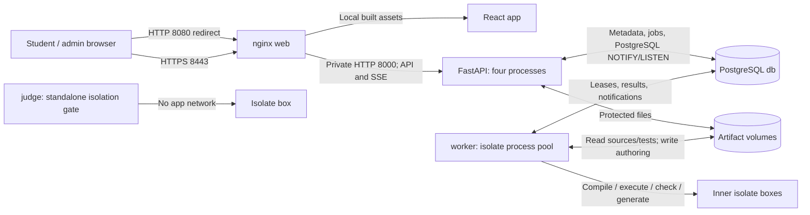

# Network Architecture

This describes the current Compose deployment. [Docker deployment](docker.md) lists services and volumes; [schema](schema.md) covers stored data.



`web`, `api`, and `db` share Compose's default network. `db` also joins internal `judge_queue` with `worker`; the worker has no default-network attachment. Only nginx publishes host ports. PostgreSQL port 5432 and API port 8000 remain private. The standalone `judge` has `network_mode: none`; inner student programs have no network access. API and worker exchange queue state via PostgreSQL, not direct HTTP. API processes receive event invalidations through PostgreSQL `LISTEN`; browser EventSource reconnects and fetches authoritative snapshots. nginx disables buffering for SSE and uses a 60-second read timeout.

## Address, trust, and client IP

`CJUDGE_BIND_ADDRESS` controls the host interface for both published web ports; default `127.0.0.1`. `0.0.0.0` exposes them on every IPv4 interface. `CJUDGE_ALLOWED_HOSTS` limits accepted HTTP hosts in FastAPI. `CJUDGE_PUBLIC_ORIGIN` is **one exact HTTPS origin** used for login and write-origin checks. Therefore, even with multiple allowed hosts or all-interface binding, writes from two different IP-address URLs cannot both work today. Multiple-address support is planned in M19.

nginx sends `Host` and `X-Real-IP` to FastAPI. The API accepts `X-Real-IP` only when its TCP peer resolves to the configured trusted web container; otherwise it uses the peer IP. A separate upstream proxy can make nginx's `$remote_addr` the proxy/router address unless nginx is configured to trust that proxy. Submission IPs and strict-IP lab binding use this selected address; MAC address collection is not implemented. Do not treat arbitrary browser headers as trusted client identity.

`certs/server.crt` and `certs/server.key` are mounted read-only into nginx. The certificate's subject alternative names must include the hostname/IP used by browsers; browsers must trust the certificate. HTTP 8080 redirects to the same host on HTTPS 8443. Sessions and lab bindings use Secure, HttpOnly cookies; application writes also require CSRF tokens. Keep the private key on the server.

For the current LAN setup and certificate commands, see [README LAN setup](../README.md#lan-setup). To check the published address and service state without modifying data, run:

```sh
docker compose --profile judging ps
sh scripts/smoke.sh https://localhost:8443 http://localhost:8080
```

The second command checks localhost only if the configured public origin and certificate cover localhost; use the configured LAN URL otherwise. The M9 second-device offline browser check remains outstanding. M19 will add simultaneous localhost/Wi-Fi/Ethernet support; this document intentionally describes current behavior.
