# Database Schema

Current PostgreSQL schema through Alembic revision `20261013_ta_labs`. `PK` marks primary-key columns; `FK` marks database-enforced foreign keys. Composite keys list every component. Case ZIPs, PDFs, submissions, authoring artifacts, and export ZIPs live in protected volumes; the database stores their identifiers and metadata.

```mermaid
erDiagram
    accounts {
        uuid id PK
        string username UK
        string role
    }
    sessions {
        string token_hash PK
        uuid account_id FK
    }
    login_attempts {
        string identifier PK
    }
    audit_events {
        bigint id PK
        uuid actor_id FK
        uuid subject_id FK
    }
    tasks {
        uuid id PK
    }
    task_revisions {
        uuid id PK
        uuid task_id FK
    }
    labs {
        uuid id PK
        boolean legacy_archived_marks
    }
    lab_tasks {
        uuid lab_id PK,FK
        int position PK
        uuid revision_id FK
        decimal maximum_marks
        decimal ta_maximum
    }
    lab_enrollments {
        uuid lab_id PK,FK
        uuid account_id PK,FK
        uuid frozen_by FK
        uuid cancelled_by FK
    }
    lab_tas {
        uuid lab_id PK,FK
        uuid ta_id PK,FK
    }
    ta_reviews {
        uuid lab_id PK,FK
        uuid student_id PK,FK
        uuid owner_id FK
        uuid reviewer_id FK
        int version
        boolean needs_recheck
    }
    ta_review_marks {
        uuid lab_id PK,FK
        uuid student_id PK,FK
        uuid task_id PK,FK
        bigint earned_numerator
        bigint earned_denominator
        boolean done
    }
    lab_pdfs {
        uuid id PK
        uuid lab_id FK
        uuid replaces_id FK
    }
    lab_announcements {
        uuid id PK
        uuid lab_id FK
        uuid author_id FK
        uuid recipient_id FK
    }
    submissions {
        uuid id PK
        uuid lab_id FK
        uuid account_id FK
        uuid revision_id FK
    }
    judge_jobs {
        uuid submission_id PK,FK
        uuid revision_id FK
        uuid batch_id FK
    }
    judge_turns {
        uuid account_id PK,FK
    }
    judge_workers {
        int slot PK
    }
    judge_attempts {
        uuid id PK
        uuid submission_id FK
    }
    judge_runs {
        uuid id PK,FK
        uuid submission_id FK
        uuid revision_id FK
    }
    judge_case_results {
        uuid run_id PK,FK
        int number PK
    }
    submission_reviews {
        uuid submission_id PK,FK
        uuid run_id FK
        uuid deleted_by FK
    }
    correction_batches {
        uuid id PK
        uuid lab_id FK
        uuid task_id FK
        uuid base_revision_id FK
        uuid revision_id FK
        uuid actor_id FK
    }
    correction_members {
        uuid batch_id PK,FK
        uuid submission_id PK,FK
        uuid run_id FK
    }
    authoring_jobs {
        uuid id PK
        uuid task_id FK
        uuid actor_id FK
    }
    authoring_attempts {
        uuid id PK
        uuid job_id FK
    }
    authoring_cases {
        uuid job_id PK,FK
        int number PK
    }
    tester_batches {
        uuid id PK
        uuid task_id FK
        uuid revision_id FK
        uuid actor_id FK
    }
    tester_sources {
        uuid id PK
        uuid batch_id FK
    }
    tester_attempts {
        uuid id PK
        uuid source_id FK
    }
    tester_cases {
        uuid source_id PK,FK
        int number PK
    }
    lab_exports {
        uuid id PK
        uuid lab_id
        smallint format_version
    }
    lab_cleanup_files {
        uuid lab_id PK
        string kind PK
        uuid artifact_id PK
    }
    alembic_version {
        string version_num PK
    }

    accounts ||--o{ sessions : account_id
    accounts ||--o{ audit_events : actor_id
    accounts ||--o{ audit_events : subject_id
    accounts ||--o{ lab_enrollments : account_id
    accounts ||--o{ lab_enrollments : frozen_by
    accounts ||--o{ lab_enrollments : cancelled_by
    accounts ||--o{ lab_tas : ta_id
    accounts ||--o{ ta_reviews : student_id
    accounts ||--o{ ta_reviews : owner_id
    accounts ||--o{ ta_reviews : reviewer_id
    accounts ||--o{ lab_announcements : author_id
    accounts ||--o{ lab_announcements : recipient_id
    accounts ||--o{ submissions : account_id
    accounts ||--o| judge_turns : account_id
    accounts ||--o{ submission_reviews : deleted_by
    accounts ||--o{ correction_batches : actor_id
    accounts ||--o{ authoring_jobs : actor_id
    accounts ||--o{ tester_batches : actor_id
    tasks ||--o{ task_revisions : task_id
    tasks ||--o{ ta_review_marks : task_id
    tasks ||--o{ correction_batches : task_id
    tasks ||--o{ authoring_jobs : task_id
    tasks ||--o{ tester_batches : task_id
    task_revisions ||--o{ lab_tasks : revision_id
    task_revisions ||--o{ submissions : revision_id
    task_revisions ||--o{ judge_jobs : revision_id
    task_revisions ||--o{ judge_runs : revision_id
    task_revisions ||--o{ correction_batches : base_revision_id
    task_revisions ||--o{ correction_batches : revision_id
    task_revisions ||--o{ tester_batches : revision_id
    labs ||--o{ lab_tasks : lab_id
    labs ||--o{ lab_enrollments : lab_id
    labs ||--o{ lab_tas : lab_id
    labs ||--o{ ta_reviews : lab_id
    ta_reviews ||--o{ ta_review_marks : student
    labs ||--o{ lab_pdfs : lab_id
    labs ||--o{ lab_announcements : lab_id
    labs ||--o{ submissions : lab_id
    labs ||--o{ correction_batches : lab_id
    labs ||..o{ lab_exports : lab_id
    labs ||..o{ lab_cleanup_files : lab_id
    lab_pdfs ||--o{ lab_pdfs : replaces_id
    submissions ||--o| judge_jobs : submission_id
    submissions ||--o{ judge_attempts : submission_id
    submissions ||--o{ judge_runs : submission_id
    submissions ||--o| submission_reviews : submission_id
    submissions ||--o{ correction_members : submission_id
    judge_attempts ||--o| judge_runs : id
    judge_runs ||--o{ judge_case_results : run_id
    judge_runs ||--o{ submission_reviews : run_id
    judge_runs ||--o{ correction_members : run_id
    correction_batches ||--o{ correction_members : batch_id
    correction_batches ||--o{ judge_jobs : batch_id
    authoring_jobs ||--o{ authoring_attempts : job_id
    authoring_jobs ||--o{ authoring_cases : job_id
    tester_batches ||--o{ tester_sources : batch_id
    tester_sources ||--o{ tester_attempts : source_id
    tester_sources ||--o{ tester_cases : source_id
```

Solid lines are enforced foreign keys; dotted lines are application references. `lab_exports` intentionally has no FK so verified receipts survive lab deletion. `lab_cleanup_files` retains artifact cleanup work after deletion. `judge_jobs.attempt_id`, `authoring_jobs.attempt_id`, and worker slot/generation fields are lease pointers without foreign keys. `alembic_version` is maintained by Alembic and has no application relationship. `login_attempts` is keyed by login identifier.

`tasks` holds mutable drafts; `task_revisions` holds immutable published configurations and case-set keys. `lab_tasks` pins an ordered revision and automatic/TA maxima. `ta_reviews` owns student claims and finalization; `ta_review_marks` stores exact earned fractions and Done flags. `lab_tas` grants TA access to a lab; `lab_enrollments` holds student binding, freeze/cancellation state, and active penalty owners. `submissions` retains accepted source metadata; `judge_attempts`, `judge_runs`, and `judge_case_results` retain execution evidence. `submission_reviews` selects the official run and stores soft deletion. `correction_batches`/`correction_members` publish full-task rejudges together. `authoring_*` holds generated-test provenance; `tester_*` holds admin-only published revision tests. `lab_exports` tracks verified archive receipts.
